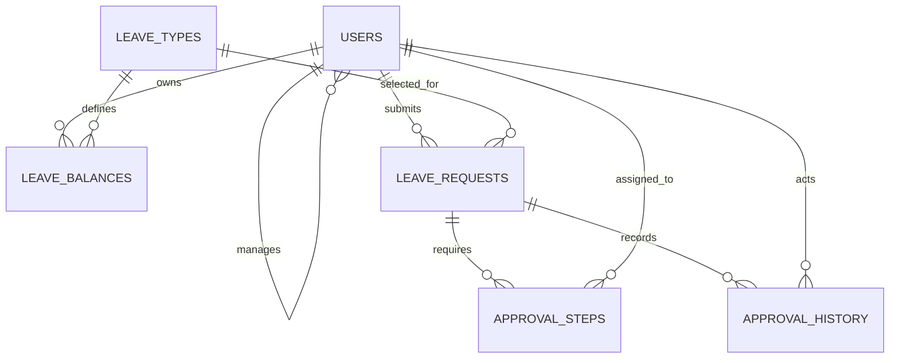

# 3. Database Schema (PostgreSQL + Prisma)

Six core tables are sufficient for the MVP. Do not create a leave-balance transaction table or notifications table.

## 3.1 Entity relationship overview



## 3.2 Tables

### users
| Column | Type | Rules |
|---|---|---|
| id | UUID | Primary key |
| name | VARCHAR(120) | Required |
| email | VARCHAR(255) | Required, unique |
| password_hash | TEXT | Required |
| role | ENUM | EMPLOYEE, PROJECT_MANAGER, HR |
| manager_id | UUID | Nullable FK to users.id |
| is_active | BOOLEAN | Default true |
| created_at | TIMESTAMPTZ | Default now |
| updated_at | TIMESTAMPTZ | Updated on change |

### leave_types
| Column | Type | Rules |
|---|---|---|
| id | UUID | Primary key |
| code | VARCHAR(40) | Unique: PAID_LEAVE, CASUAL_LEAVE, SICK_LEAVE, UNPAID_LEAVE |
| name | VARCHAR(80) | Display name |
| annual_allowance | DECIMAL(6,2) | 6, 4, 4, 10 |
| is_active | BOOLEAN | Default true |

### leave_balances
| Column | Type | Rules |
|---|---|---|
| id | UUID | Primary key |
| user_id | UUID | FK users.id |
| leave_type_id | UUID | FK leave_types.id |
| year | INTEGER | Calendar leave year |
| allocated | DECIMAL(6,2) | Initial allowance |
| used | DECIMAL(6,2) | Default 0 |
| reserved | DECIMAL(6,2) | Default 0 |
| created_at | TIMESTAMPTZ | Default now |
| updated_at | TIMESTAMPTZ | Updated on change |

Unique constraint: `(user_id, leave_type_id, year)`.

`available` is calculated as `allocated - used - reserved`; it does not need to be stored.

### leave_requests
| Column | Type | Rules |
|---|---|---|
| id | UUID | Primary key |
| employee_id | UUID | FK users.id |
| leave_type_id | UUID | FK leave_types.id |
| start_date | DATE | Required |
| end_date | DATE | Required |
| duration_type | ENUM | FULL_DAY, HALF_DAY |
| start_time | TIME | Nullable; required for HALF_DAY |
| end_time | TIME | Nullable; server-calculated for HALF_DAY |
| total_days | DECIMAL(6,2) | Server-calculated: 0.5 or integer |
| reason | TEXT | Required |
| status | ENUM | PENDING, APPROVED, REJECTED, CANCELLED |
| created_at | TIMESTAMPTZ | Default now |
| updated_at | TIMESTAMPTZ | Updated on change |

### approval_steps
| Column | Type | Rules |
|---|---|---|
| id | UUID | Primary key |
| leave_request_id | UUID | FK leave_requests.id |
| approver_id | UUID | FK users.id |
| approver_role | ENUM | PROJECT_MANAGER, HR |
| status | ENUM | PENDING, APPROVED, REJECTED, CANCELLED |
| comments | TEXT | Nullable |
| action_at | TIMESTAMPTZ | Nullable |
| created_at | TIMESTAMPTZ | Default now |

Unique constraint: `(leave_request_id, approver_id)`.

### approval_history
| Column | Type | Rules |
|---|---|---|
| id | UUID | Primary key |
| leave_request_id | UUID | FK leave_requests.id |
| actor_id | UUID | FK users.id |
| action | VARCHAR(40) | REQUEST_SUBMITTED, APPROVED, REJECTED, CANCELLED |
| comments | TEXT | Nullable |
| created_at | TIMESTAMPTZ | Default now |

## 3.3 Prisma schema outline

```prisma
enum UserRole {
  EMPLOYEE
  PROJECT_MANAGER
  HR
}

enum LeaveDurationType {
  FULL_DAY
  HALF_DAY
}

enum LeaveRequestStatus {
  PENDING
  APPROVED
  REJECTED
  CANCELLED
}

enum ApprovalStatus {
  PENDING
  APPROVED
  REJECTED
  CANCELLED
}

model User {
  id           String   @id @default(uuid()) @db.Uuid
  name         String   @db.VarChar(120)
  email        String   @unique @db.VarChar(255)
  passwordHash String   @map("password_hash")
  role         UserRole
  managerId    String?  @map("manager_id") @db.Uuid
  isActive     Boolean  @default(true) @map("is_active")
  createdAt    DateTime @default(now()) @map("created_at")
  updatedAt    DateTime @updatedAt @map("updated_at")

  manager      User?    @relation("ManagerReports", fields: [managerId], references: [id])
  teamMembers  User[]   @relation("ManagerReports")
  balances     LeaveBalance[]
  requests     LeaveRequest[]
  approvals    ApprovalStep[]
  history      ApprovalHistory[]

  @@map("users")
}

model LeaveType {
  id              String @id @default(uuid()) @db.Uuid
  code            String @unique @db.VarChar(40)
  name            String @db.VarChar(80)
  annualAllowance Decimal @db.Decimal(6, 2) @map("annual_allowance")
  isActive        Boolean @default(true) @map("is_active")
  balances        LeaveBalance[]
  requests        LeaveRequest[]
  @@map("leave_types")
}

model LeaveBalance {
  id          String   @id @default(uuid()) @db.Uuid
  userId      String   @map("user_id") @db.Uuid
  leaveTypeId String   @map("leave_type_id") @db.Uuid
  year        Int
  allocated   Decimal  @db.Decimal(6, 2)
  used        Decimal  @default(0) @db.Decimal(6, 2)
  reserved    Decimal  @default(0) @db.Decimal(6, 2)
  createdAt   DateTime @default(now()) @map("created_at")
  updatedAt   DateTime @updatedAt @map("updated_at")
  user        User     @relation(fields: [userId], references: [id])
  leaveType   LeaveType @relation(fields: [leaveTypeId], references: [id])
  @@unique([userId, leaveTypeId, year])
  @@map("leave_balances")
}

model LeaveRequest {
  id           String @id @default(uuid()) @db.Uuid
  employeeId   String @map("employee_id") @db.Uuid
  leaveTypeId  String @map("leave_type_id") @db.Uuid
  startDate    DateTime @map("start_date") @db.Date
  endDate      DateTime @map("end_date") @db.Date
  durationType LeaveDurationType @map("duration_type")
  startTime    String? @map("start_time") @db.VarChar(5)
  endTime      String? @map("end_time") @db.VarChar(5)
  totalDays    Decimal @map("total_days") @db.Decimal(6, 2)
  reason       String
  status       LeaveRequestStatus @default(PENDING)
  createdAt    DateTime @default(now()) @map("created_at")
  updatedAt    DateTime @updatedAt @map("updated_at")
  employee     User @relation(fields: [employeeId], references: [id])
  leaveType    LeaveType @relation(fields: [leaveTypeId], references: [id])
  approvalSteps ApprovalStep[]
  history      ApprovalHistory[]
  @@index([employeeId, startDate, endDate])
  @@index([status, createdAt])
  @@map("leave_requests")
}

model ApprovalStep {
  id             String @id @default(uuid()) @db.Uuid
  leaveRequestId String @map("leave_request_id") @db.Uuid
  approverId     String @map("approver_id") @db.Uuid
  approverRole   UserRole @map("approver_role")
  status         ApprovalStatus @default(PENDING)
  comments       String?
  actionAt       DateTime? @map("action_at")
  createdAt      DateTime @default(now()) @map("created_at")
  leaveRequest   LeaveRequest @relation(fields: [leaveRequestId], references: [id])
  approver       User @relation(fields: [approverId], references: [id])
  @@unique([leaveRequestId, approverId])
  @@index([approverId, status])
  @@map("approval_steps")
}

model ApprovalHistory {
  id             String @id @default(uuid()) @db.Uuid
  leaveRequestId String @map("leave_request_id") @db.Uuid
  actorId        String @map("actor_id") @db.Uuid
  action         String @db.VarChar(40)
  comments       String?
  createdAt      DateTime @default(now()) @map("created_at")
  leaveRequest   LeaveRequest @relation(fields: [leaveRequestId], references: [id])
  actor          User @relation(fields: [actorId], references: [id])
  @@index([leaveRequestId, createdAt])
  @@map("approval_history")
}
```

**Implementation note:** Prisma's PostgreSQL `TIME` mapping support varies by Prisma version and generated client. The outline stores time as `HH:mm` text for portability; alternatively use PostgreSQL `TIME` through a supported native type. Validate and normalize times in the service layer.

## 3.4 Atomic balance reservation
Use a conditional update in the same transaction as request creation:

```sql
UPDATE leave_balances
SET reserved = reserved + :requested_days,
    updated_at = NOW()
WHERE user_id = :employee_id
  AND leave_type_id = :leave_type_id
  AND year = :leave_year
  AND allocated - used - reserved >= :requested_days
RETURNING id, allocated, used, reserved;
```

If no row is returned, the balance is insufficient. Do not create the leave request or approval steps.

## 3.5 Indexes and constraints
- Unique `users.email`.
- Unique `(user_id, leave_type_id, year)` on balances.
- Unique `(leave_request_id, approver_id)` on approval steps.
- Index `approval_steps(approver_id, status)`.
- Index `leave_requests(employee_id, start_date, end_date)`.
- Index `leave_requests(status, created_at)`.
- Add check constraints where practical: `allocated >= 0`, `used >= 0`, `reserved >= 0`, `total_days > 0`.
- Enforce `used + reserved <= allocated` where business rules allow; if HR can adjust allocation, validate adjustment first.
